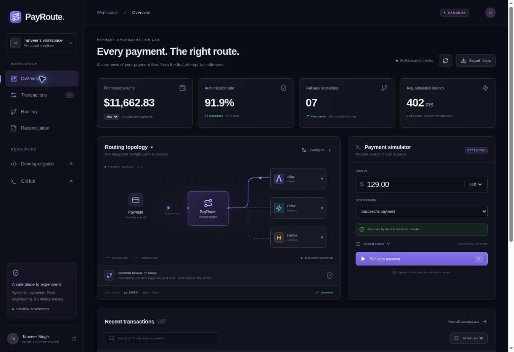

# PayRoute Sandbox

[**Open live demo**](https://payroute-sandbox.vercel.app) · [Verification record](docs/verification.md) · [Design decisions](docs/design.md)

A payment orchestration lab by [Tanveer Singh](https://singhtanveer.com). Route synthetic payments through three simulated providers, trigger outages, inspect retries and reconcile a settlement statement. Every payment is sandbox data. No real providers, card details, funds or payment networks are involved.



## What works

- Priority routing through **Atlas → Pulse → Harbor**, with server-validated priority and enabled/outage settings.
- Deterministic success, primary outage, terminal hard decline and all-provider-outage scenarios.
- Exact integer minor-unit amounts for AUD, USD, CAD and EUR; decimal input with excess precision is rejected, never silently rounded.
- Idempotent payment commands: the same key and normalized payload return the original saved result; a changed payload is rejected. Atomic PostgreSQL compare-and-swap and retry protect concurrent commands.
- Actual settlement CSV comparison: missing, duplicate, unexpected, currency mismatch and amount mismatch exceptions. The demo statement intentionally contains three exceptions.
- Currency-scoped processed volume, authorization rate, recovered payments and simulated latency calculated from the workspace ledger.
- Search, status filters, payment detail timeline, responsive navigation, provider configuration, CSV and JSON exports, explicit reset and visible persistence errors.
- An isolated browser workspace seeded with 36 synthetic payments, capped at 200 to preserve idempotency history without unbounded storage.

## Stack

React 19, TypeScript, Vite, Lucide icons, Node Vercel API and Supabase PostgreSQL. Dependencies use exact versions and `package-lock.json`. The server talks only to a validated Supabase project origin; payment simulation makes no network calls. The frontend has a restrictive content security policy and no third-party scripts or fonts.

## Run locally

```bash
npm ci
cp .env.example .env.local
# Populate SUPABASE_URL and SUPABASE_PUBLISHABLE_KEY in .env.local.
# Apply db/schema.sql to your Supabase project after reviewing its preflight.
npm run dev
```

Open `http://localhost:5103`. The Vite development server includes the same workspace API handler used on Vercel. The two environment variables are server-side only. A configured database is required; the UI reports storage errors and never pretends local data was persisted. [Persistence setup and RLS verification](docs/persistence.md) describe the shared capability model and migration checks.

```bash
npm test             # domain, token lifecycle and persistence/API contracts
npm run typecheck
npm run build
```

## Deploy to Vercel

Import this repository as a Vite project. The checked-in `vercel.json` sets the build and SPA routes; `api/workspace.ts` is a Node function. Set `SUPABASE_URL` and `SUPABASE_PUBLISHABLE_KEY` for the deployment. Apply the reviewed `db/schema.sql` once to an appropriate Supabase project. The publishable key must use the current `sb_publishable_` format, not a service-role key or a legacy JWT key. Keep credentials outside Git.

## Domain and API

`src/domain.ts` contains the deterministic reducer, amount parser, CSV parser, reconciliation and exports. `api/workspace.ts` binds it to `api/_lib/workspace.ts`, which validates capability tokens and bounds requests. `api/_lib/store.ts` loads and saves through RLS-protected PostgreSQL CAS.

```http
POST /api/workspace
Authorization: Bearer <64 lowercase hexadecimal workspace token>
Content-Type: application/json

{"command":{"type":"simulate","amount":"129.00","currency":"AUD","scenario":"primary_outage","reference":"Sandbox order","key":"example_payment_01"}}
```

`GET` returns `{state,revision}`. `POST` returns `{state,revision,result?}`. Payment result contains `{payment,replayed}`. Validation fails with 400, contention with 409, missing/invalid tokens with 401 and storage unavailability with 503. No token is returned in UI exports.

Other commands: `{type:"provider",id:"atlas",enabled:true,outage:false}`, `{type:"route",order:["pulse","atlas","harbor"]}`, `{type:"reconcile",demo:true}`, `{type:"reconcile",csv:"..."}`, `{type:"reset"}`.

Settlement CSV uses exactly `transaction_id,amount_minor,currency`. Maximum 500 records and 30 KB. The parser supports quoted CSV fields; invalid rows are rejected. Reconciliation considers successful payments only; duplicate rows never count as a clean match. CSV exports neutralize formula-like reference values.

## Explicit limitations

This is a portfolio demonstration, not a production payment product. Providers and fees are fictional. Latency is deterministic modeled latency, not elapsed wall-clock time; timestamps advance along a fixed synthetic demo clock beginning 30 October 2026 at 08:00 UTC. Processing is synchronous and no real settlement occurs. No circuit breaker, fraud scoring, currency conversion, bank integration, card processing, user accounts or financial compliance guarantees are implemented.

Workspace access is a random 256-bit bearer capability kept in browser local storage. Anyone with the token can access that workspace. Do not store sensitive data. Database access expires after seven days and the browser rotates its token after six days, starting a new seeded workspace. Resetting a sandbox restores the seed and clears its idempotency history. At 200 payments, new requests are rejected until reset; existing-key replays continue to work.

See [design](docs/design.md), [implementation plan](docs/implementation-plan.md) and [test coverage](docs/testing.md).

## Author

[Tanveer Singh](https://singhtanveer.com) · [GitHub: tanveerchana](https://github.com/tanveerchana)
